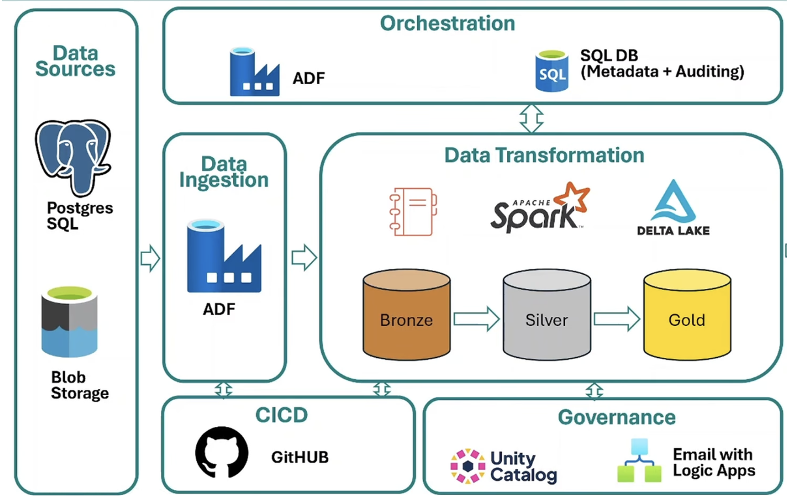
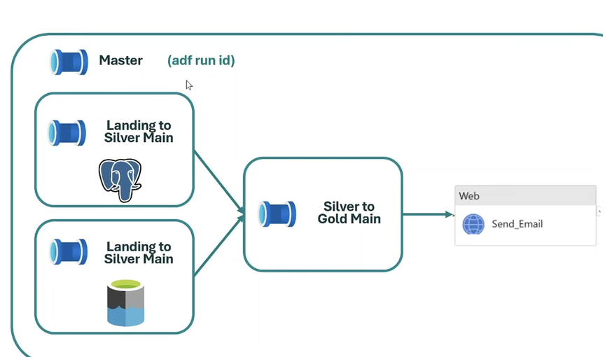
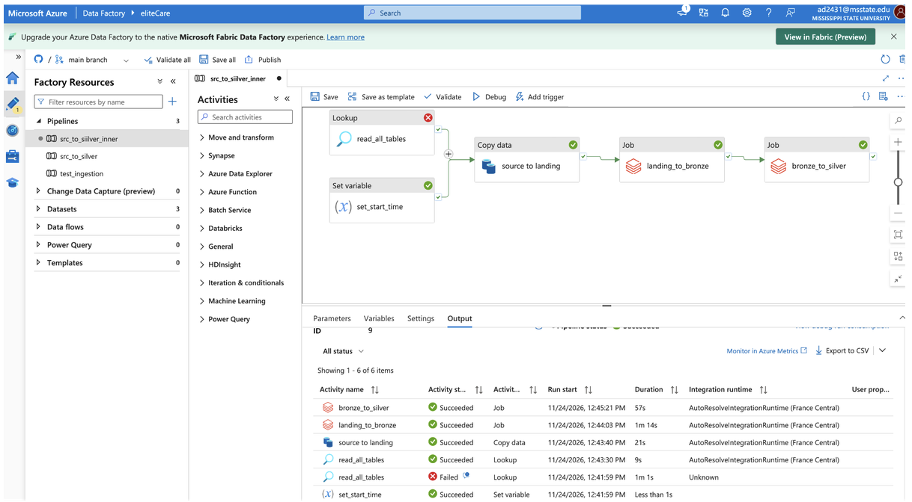
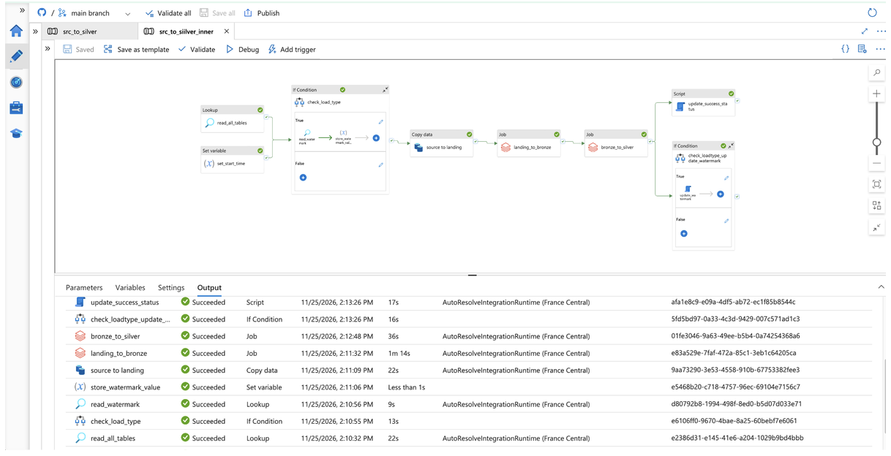
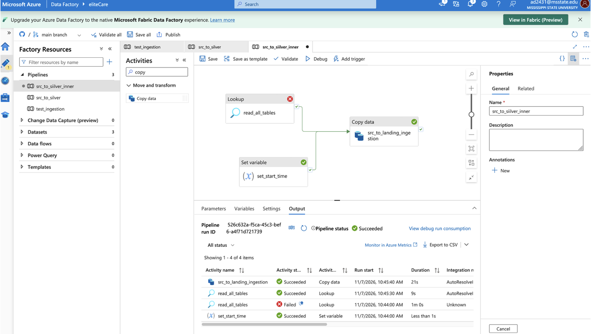
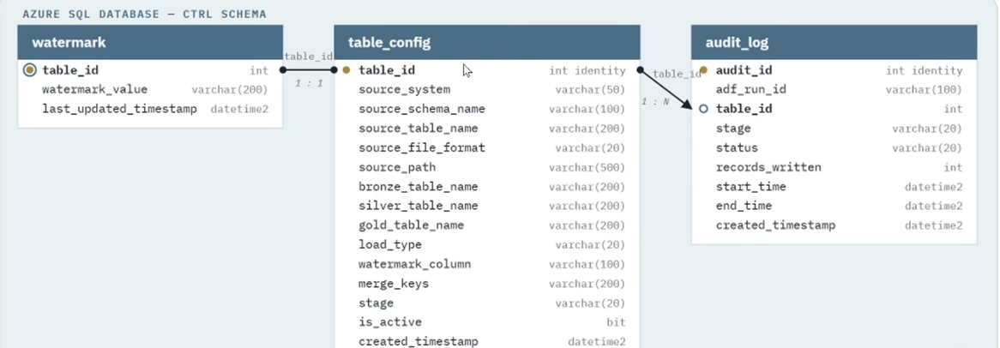

# EliteCare Data Platform

An Azure project for  healthcare data from Neon PostgreSQL and Azure Data Lake Storage into a Databricks medallion lakehouse. Pipeline behavior is driven by Azure SQL metadata, with run status recorded in an audit table.

> **At a glance** · Azure Data Factory · Neon PostgreSQL · ADLS Gen2 · Azure SQL · Azure Databricks · Bronze → Silver → Gold

## Architecture



ADF coordinates ingestion and transformation. PostgreSQL and partner CSV files are landed in the lake, processed through Bronze and Silver, then curated into Gold tables. Azure SQL stores table configuration, watermarks, and audit history. 

## Data flow

1. **`MASTER_PL`** starts `src_to_silver` for the `neon_postgres` and `adls_csv` source systems.
2. **`src_to_silver`** reads active table IDs from `ctrl.table_config`, then processes each configured source table through `src_to_siilver_inner`.
3. **`src_to_siilver_inner`** reads the table configuration, checks load type and watermark where applicable, and invokes Databricks jobs for Landing → Bronze and Bronze → Silver. It records run outcomes in `ctrl.audit_log`.
4. **`silver_to_gold`** selects active Gold targets from the configuration and invokes a Databricks job for each target, updating audit status.

The master pipeline waits for both source pipelines to finish before it starts the Gold pipeline. The source loop is configured for parallel table processing. 









## Data and load strategy

The metadata seed script configures five source objects and three Gold targets:

| Source system | Objects | Load strategy |
| --- | --- | --- |
| Neon PostgreSQL | `public.hospitals`, `public.doctors` | Full load |
| Neon PostgreSQL | `public.patients` | Merge by `patient_id`, using `updated_at` as watermark |
| ADLS CSV | `lab_results` | Incremental load using `reported_at` as watermark |
| ADLS CSV | `insurance_providers` | Full load |
| Silver layer | `patient_360`, `hospital_daily_summary`, `lab_test_trends` | Full Gold rebuild |


## Metadata and auditing


| Table | Purpose |
| --- | --- |
| `ctrl.table_config` | Per-table source, target, load strategy, watermark, merge keys, stage, and active flag |
| `ctrl.watermark` | Last processed watermark per configured table |
| `ctrl.audit_log` | Per-run and per-stage status, record count, and timestamps |

Watermarks for the initial incremental loads are seeded to `1900-01-01T00:00:00`. See the [control schema diagram](docs/images/control-schema.png).



## Repository layout

```text
EliteCare/
├── data_sources/postgres_neon/       # PostgreSQL source DDL and sample data
├── dataset/                          # ADF dataset definitions
├── linkedService/                    # ADF connection definitions
├── metadata_queries/                  # Azure SQL control schema and seed data
├── pipeline/                         # ADF pipeline JSON definitions
├── docs/images/                      # Architecture and ADF screenshots
└── publish_config.json               # ADF publish branch settings
```

## Getting started

### Prerequisites

- An Azure Data Factory instance configured for Git integration.
- Azure SQL Database for the `ctrl` metadata schema.
- Neon PostgreSQL with permission to create the sample source tables.
- ADLS Gen2 storage with the expected CSV inputs.
- An Azure Databricks workspace and jobs for the Bronze, Silver, and Gold transformations.
- Azure Key Vault and credentials/access policies for the linked services.


## ADF assets

| Asset | Role |
| --- | --- |
| `pipeline/MASTER_PL.json` | Entry point: source ingestion followed by Gold processing |
| `pipeline/src_to_silver.json` | Enumerates active source tables for a source system and audits each run |
| `pipeline/src_to_siilver_inner.json` | Per-table landing, Bronze, and Silver processing |
| `pipeline/silver_to_gold.json` | Enumerates configured Gold tables and runs transformations |
| `pipeline/test_ingestion.json` | Example copy from PostgreSQL to Parquet in ADLS |
| `linkedService/` and `dataset/` | Connection and dataset definitions referenced by pipelines |

## Configuration notes

- The JSON files are Azure Data Factory exported assets; deploy them in a compatible factory and supply valid linked services.
- Connection definitions reference Key Vault secrets. Keep credentials in Key Vault and rotate or replace any environment specific values before deployment.
- The pipelines contain Databricks job IDs tied to an existing workspace. Replace these IDs and parameters with the job configuration for your environment.
- The repository includes orchestration and SQL setup, but not the Databricks notebooks/jobs, Azure resources, partner CSV files, or a complete CI/CD deployment workflow.
- `publish_config.json` sets the ADF publish branch to `adf_publish`.

## Run monitoring

Each table and stage writes an `IN_PROGRESS` audit record, then updates it to `SUCCESS` or `FAILED` with timestamps. Query `ctrl.audit_log` by `adf_run_id`, `table_id`, and `stage` to inspect pipeline outcomes. Check ADF Monitor for activity-level errors and Databricks job runs for transformation details.


